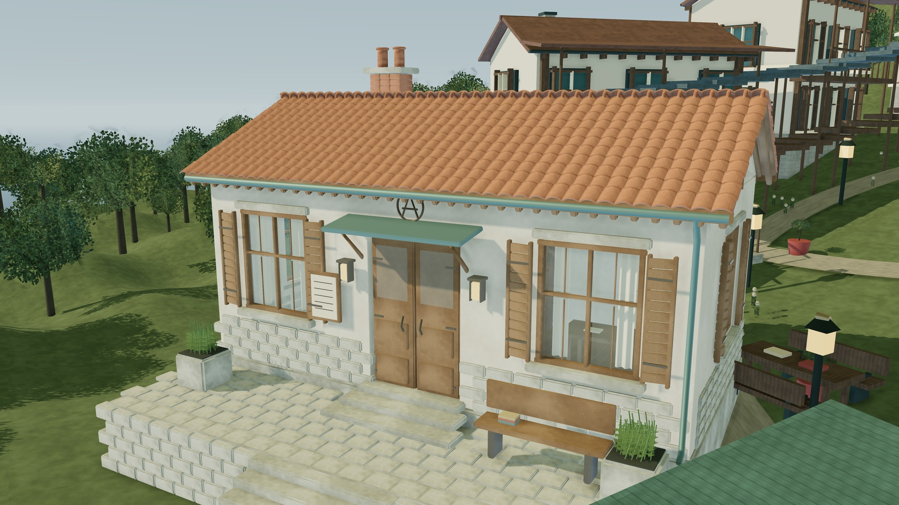
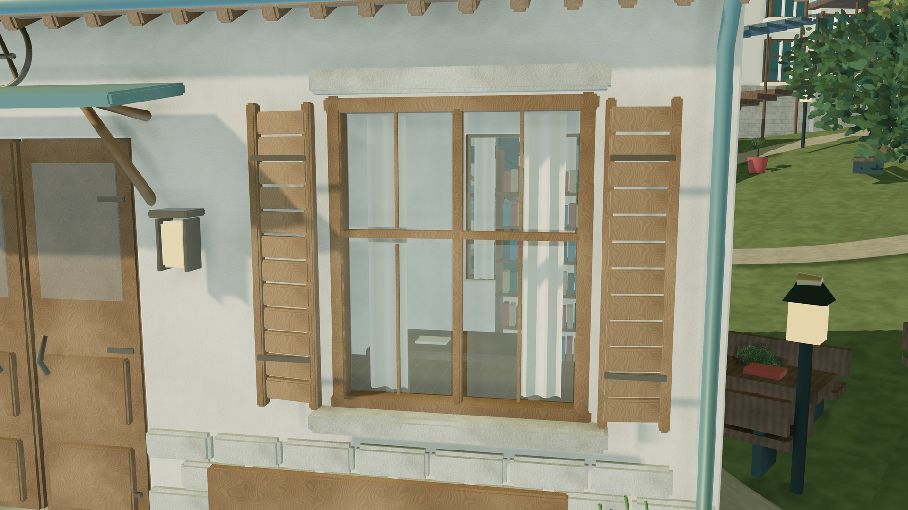
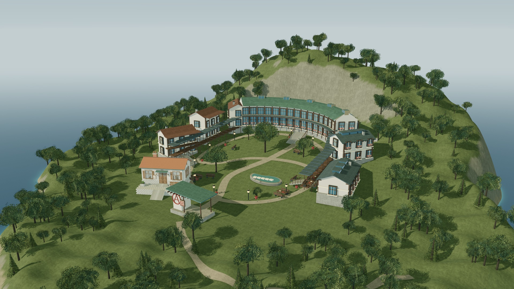

# Pierteia · 庭院人眼与参考材质 / 互动草稿 11

本轮把上次的美术审计落实到**学院阅览室及入口庭院**，不是全星球美术完工。开放环形山地布局、低入口圈A和原有Blender阅览室保留；正式海陆、地点与归属不变。

## 直接在线检查

在草稿预览地址后加：

- `?site=900&inspect&frame=courtyard`：**庭院人眼**，镜头在铺地上方1.65米；可继续拖动环绕。
- `?site=900&inspect&frame=joinery`：**窗与木作**，检查木纹、窗框、帘幕和透射。
- `?site=900&inspect&frame=wide`：全校布局。

新增两个对应按钮，并修复短窗口下按钮溢出屏幕的问题，详情面板可滚动。原图书馆、教学楼、工坊机位保留。镜头不是离线图片，HDR也只用于照明和反射，不作为场景背景。

## 这轮实际改动

- **尺度**：学院采用1.70米简化尺度人物，脚底对齐铺地；减少均匀撒布的人数。其他地区仍沿用原占位方式，尚未完成逐区尺度重做。
- **机位**：庭院镜头离选定可站立表面1.65米，47°垂直视角；修正OrbitControls对仰视的限制，并检查实际相机没有被自动移回高位。退出后恢复全景镜头参数。
- **场地**：新石板庭院接上原阅览室阶梯，增加低坐凳；地形局部整平，树木和地被避让，避免穿过铺地。未改变正式地理数据。
- **木材和基础**：引入MaterialX参考颜色/粗糙度贴图及砌体法线，木作不再被旧程序材质覆盖或二次染棕。参考贴图不宣称来自扫描。
- **玻璃**：原Blender阅览室恢复物理透射、非金属玻璃、IOR和薄玻璃厚度；透明/透射表面不再进入不适合它们的AO预通道，不投射实心墙式阴影。
- **照明**：学院使用Poly Haven摄影HDR的PMREM环境，并降低填充光以保留主光方向；其他七景仍使用原环境。增加资源失败清理与重试，返回星球时恢复环境强度、太阳强度和视角。
- **立面取舍**：弧形图书馆只在部分内侧开间保留窗内书架，减少每格都铺满书本的重复。

摄影HDR为512×256照明衍生文件，参考表面为最长边1024像素；不是“最高规格扫描资产包”。来源、许可、修改方法和SHA见 [assets/study/README.md](assets/study/README.md) 与 [manifest.json](assets/study/manifest.json)。本轮没有安装Substance、SpeedTree、CSM或WebGPU路径追踪器，也没有宣称做了GI烘焙。

## 验证

- `node tools/test-study.mjs`：测量实际人物网格1.70米、脚底、庭院相机1.65米，校验资源SHA和HDR有限值。
- `research/v11-study-audit.json`：本轮静态尺度记录；实际浏览器相机坐标另见浏览器回归报告。
- `tools/verification-v11.json`：八景切换、八个普通分辨率近景检查、相机参数恢复。
- `tools/verification-loading-v11.json`：共享贴图、新参考贴图、HDR、GLB故障注入与重试、取消和快速切换。
- `node tools/validate.mjs`：正式地图SHA、历史资产、当前入口与验证记录。
- `node tools/audit-art-scale.mjs`：**固定读取0f7f1ae的历史v10审计**，需Git历史；它故意不把旧报告冒充当前状态。新尺度以`test-study.mjs`为准。

仍有明显待完善项：山体/植被和其他楼体没有达到统一质量，近景人物是尺度示意，室内与间接光尚不完整。功能和数值测试通过不代表美术已获认可。本轮先交真实可交互画面，不新增4K图集。

每批已提交并推送 `arena/4c4cfaac-ynxz`；不合main、不替换主站、不自动部署。

---
<details><summary>v10与之前的历史说明（不代表当前状态）</summary>

> **2026-10-15 美术复盘：** 用户仍明确不认可当前画面。已补查其提供的资料、官方渲染文档、环境艺术案例及实物参考，见 [调研与源码审计](research/README.md)、[下一样板标准](DESIGN.md)。实测发现人物尺度与近景相机高度等基础问题；这些是待修项，不因为v10功能测试通过而被视为美术达标。**本轮是研究与可执行审计，没有发布新的场景样板，也没有改变v10画面。**

# Pierteia · 学院翼楼精修 / 互动草稿 10

这一轮继续改善学院其余楼体的实际结构，不是重新渲染旧样板。**仍保留开放环形山地布局、分散教学楼、低入口圈A和现有Blender阅览室**，正式地图和地点档案不改。

## 本轮已接入

- **三栋教学楼、两栋工坊**：从实心墙盒改为有厚度的四面墙体，门窗是实际洞口；新增凹进玻璃、窗套、外凸窗台、门把手和入口踏步。楼板与阳台按各栋楼层高度对齐，阳台下补斜撑。
- **立面差异**：教学楼使用不同窗宽、屋顶起坡、瓦色和木百叶组合；工坊改用更宽的采光窗，避免五栋楼完全复制同一张立面。
- **弧形图书馆**：去掉填实整个弧形体积的墙块，保留基础和分层楼板；内外两侧及两端使用真实开窗的厚墙。弧墙洞口随原有弧线弯曲，不围成完整圆筒。
- **窗内细部**：书架和书本放在玻璃后方的浅窗间，而不是挂在窗外。新玻璃为低透明度实时近似，不伪称路径追踪折射；没有完整房间或可漫游室内。
- **连续有顶连廊**：将逐块重叠的屋面和地板换成沿坡连续的铺板及浅坡屋顶，增加檐沟、细立边缝、栏杆和柱头斜撑；书架的书脊颜色、高度、空位和倾斜不再完全重复。
- **三个新近景机位**：图书馆、教学楼、工坊。保留原有全景、阅览室建筑近景和材质机位。新增按钮只在学院显示，可换行排列。

## 在线近看

使用 Arena 的「星球图志 · 美术返工版」预览，或在此目录运行 `python -m http.server 8135 --bind 0.0.0.0`。

- 图书馆：`?site=900&inspect&frame=library`
- 教学楼：`?site=900&inspect&frame=teaching`
- 工坊：`?site=900&inspect&frame=workshop`

拖动环绕、滚轮近看；Esc返回星球。**本轮不新增4K图集**，以下旧图折叠保留，不代表当前效果。

## 验证与保存约定

- `node tools/test-architecture.mjs`：用射线检查直墙与弧墙的洞口确实穿透，窗侧壁、窗台及过梁仍为实体，并检查越界、重叠和非有限参数。
- `tools/verification-v10.json`：本轮浏览器回归记录；`tools/verification-loading-v10.json`：本轮加载失败、重试和取消回归。普通分辨率测试不是美术评分或硬件性能基准。
- `node tools/validate.mjs`：校验缓存版本、正式地理SHA、历史资产与各版验证记录。
- **每一轮完成后都提交并推送到 `arena/4c4cfaac-ynxz`，较大改动分批推送。** 不以“已在沙盒写入”代替GitHub保存；最终回复附实际提交号。仍不合并main、不改主站、不自动部署。
- 当前只是持续精修的一批：其他国家大型地标仍有重复造型，完整室内、扫描材质和全局光照烘焙尚未完成。

---

<details><summary>第九版及以前的历史记录（不是本轮效果）</summary>

# Pierteia · 美术返工 / 互动草稿 09

上一版即使接入了PBR，仍有纸片树冠、亮蓝窗面、噪点地表和重复薄壳建筑的问题。这一轮改的是这些基础做法，**不是用更大的截图、更多面数宣称画面已经达标**。目前仍是继续打磨的自然主义方向工作版，不是全部资产完成的写实成品。

## 先看互动

使用 Arena 的 **「星球图志 · 美术返工版」** 在线预览。也可在本目录执行 `python -m http.server 8135 --bind 0.0.0.0`，通过HTTP打开。

- 学院近景入口：`?site=900&inspect&frame=street`。
- 法洛塔街区近景入口：`?site=falota&inspect&frame=street`。
- 拖动环绕、滚轮近看；「全景」查看场地关系，Esc返回星球，H隐藏界面。
- **本轮没有新增4K图集。** 下方折叠图集是历史版本，不代表这次画面。

## 实际返工

1. **植被不再是树叶贴图交叉片**：新建阔叶树与针叶树的分枝、细枝和独立折面叶片，八种原型按各场景位置、旋转和尺度实例化。叶片没有透明贴图裁切；保留原先树木位置和学院布局，不把林地换成圆球树。草叶由错误偏亮的线性颜色改为暗部自然绿色，缩小零散碎石。
2. **街屋从实心盒子改为厚墙、真实窗洞**：铁枢、璇玑、法洛塔、汐见町的街屋生成器加入有厚度的挤出墙体、窗洞与门洞，重新安排首层门窗，增加凹进玻璃、四边窗套和窗台，商铺另有真实开口。并非所有工厂、研究院及纪念建筑都已逐栋重建。
3. **屋面改为搭接实体**：适用的坡屋顶有逐片瓦面、微弧和外露下唇；共享静态批次不是每片单独一次绘制。学院弧形图书馆的金属屋面补立边接缝。已有Blender阅览室的搭接瓦和开洞结构保留。
4. **材质减法与层次**：压低玻璃和工业金属的蓝色及过强反射；去掉地表统一平铺的强法线噪声，改用连续的宏观色差、覆盖层差异、岩面风化和随像素尺度衰减的微观起伏；减少雪山脚部杂乱凸起和雪坡孤立石块。木纹、石材和灰泥仍是原创程序材质，不是扫描资产。
5. **照明与边缘质量**：降低蓝色环境偏色和泛光，调整局部场景曝光、阴影过滤与遮蔽强度。修正“渲染器开了抗锯齿，但后处理目标没有多重采样”的断层；在GPU支持范围内使用最多4次MSAA，再以SMAA处理最终画面边缘。正式星球的曝光保留。

## 检查与边界

- `tools/verification-v9.json`：八景实际浏览器加载与普通分辨率渲染，检查新植被、四区街屋标志、MSAA/SMAA、机位和返回；另有学院及法洛塔1100×700近景检查。临时检查图不入库、不作为新图集。
- `tools/verification-loading-v9.json`：纹理/GLB故障注入、重试、取消、慢请求竞态、Esc与搜索重入。故意注入的两次网络失败单独记录。
- `node tools/validate.mjs`：当前引用、正式地理SHA、GLB、历史记录及v9检查记录。浏览器检查基于Chromium软件WebGL，**不是桌面显卡性能测试，也不是美术质量的自动评分**。
- `vegetation.js` / `roof-detail.js` / `regional-scenes.js` 是本轮主要几何源；`world-finish.js` 是共享表面处理。SMAA来自同版本Three.js r170，沿用库的MIT许可。
- 仍未完成每栋建筑的独立造型、完整室内、扫描材质或全局光照烘焙。玻璃有实时近似；其他大型楼体仍有重复感，不以这一轮宣布最终完成。
- 原有20标记、28地点及parent、正式海陆和湖泊不动。仍为独立草稿，**不改主站、不合main、不自动上线**。按需加载、进度、取消与失败重试继续保留。

---

<details><summary>第八版及以前的历史记录（不是当前效果）</summary>

# Pierteia · 全场景材质与环境 / 互动草稿 08

**本轮优先交互，不新增4K成片。** 星球可旋转缩放，现有8个三维场景均可进入、近看、返回；下方第七版图集仅保留历史记录，**不是第八版截图**。

## 在线查看

Arena会话中的 **「星球图志 v8 · 互动草稿」Live Preview** 是本轮交互入口。预览是临时开发服务，不是主站部署；若会话停止，按下面的方法本地运行即可。GitHub文件页本身不会执行三维网页。

1. 从左侧选择地点，点击「进入场景特写」。
2. 拖动环绕、滚轮缩放，或使用「建筑近景」等机位按钮；学院另有「材质细节」。
3. Esc / 「星球全景」返回；H隐藏界面。

## 本轮改动

- **统一表面处理**：石灰岩、灰泥、木材及陶瓦的法线/粗糙度资源接入共享材质库；保留不同地区的颜色和建筑风格，叠加低幅度矿物纹理、色差、雨痕和金属氧化。木材新增三张1K方向性木纹贴图，替代过强的回旋纹；来源为原创程序生成，不是扫描。
- **建筑实体细部**：共享建筑主体与学院直线楼体加入小倒角、按尺度分配墙面UV；群岛房屋和万知城厅堂补檐沟、落水管及入口细部，街边商铺补木桶。细杆不盲目增加面数，静态几何仍按材质合批。
- **自然环境**：八景均新增实例化弯曲草丛，坡地场景散布碎石；依据高度、坡度和预留范围避开水面、主要建筑区域及高山雪区。草叶有微风动画，遵循系统减少动态效果设置。
- **全场景光照**：预过滤程序HDR环境与GTAO接触遮蔽从学院扩展到八景。专门排除透明烟雾、粒子和镂空树叶卡片的AO深度覆盖，避免原版法线替换产生黑色方块。不是离线路径追踪或全局光照烘焙。
- **星球表现**：保留既有6K海陆、地形与云层资料，微调地表低幅色差、云影软化和云缘受光；未改正式海岸或地点坐标。
- **按需加载**：先打开星球，进入局部场景才加载PBR资源；14MB学院GLB只在进入学院时请求。提供阶段进度、取消进入、失败重试，并防止较早的慢请求抢走当前场景。取消的是本次进入，已开始的共享下载可继续完成并缓存。

学院继续保留开放环形山地布局、分散楼群和低入口圈A；没有退回圆筒校舍。精细阅览室仍是现有Blender资产，**本轮没有把其他每栋建筑都重新制作成Blender资产**；其余建筑继续采用程序几何和共享PBR。28个地点档案不等于28个独立建筑场景，本轮覆盖目录中的全部8景。

## 验证与运行

- `tools/verification-v8.json`：八景实际浏览器加载、普通分辨率渲染、环境/AO开启、近景机位与返回检查；并验证星球启动时不请求学院GLB。
- `tools/verification-loading-v8.json`：故意阻断纹理/GLB后的错误提示与重试、取消和慢请求竞态、Esc、搜索重入及细节按钮检查。
- `node tools/validate.mjs`：正式地理SHA、20标记/28地点、既有GLB、历史图集及v8验证记录。
- 浏览器检查使用Chromium软件WebGL，只做普通分辨率验收，不是桌面显卡性能基准。临时检查图不作为新图集上传。
- 本目录运行 `python -m http.server 8135 --bind 0.0.0.0`，通过HTTP访问；需要WebGL 2，无运行时CDN。共享PBR与模型可加载等待。
- 木纹重建：Python + NumPy/Pillow/SciPy，运行 `python tools/build_world_wood.py`。Three.js附加倒角几何来自同版本r170，沿用 `vendor/THREE-LICENSE.txt`。
- 浏览器回归脚本：`tools/verify-browser.mjs` / `tools/verify-loading.mjs`；需要可运行的Playwright与 `@sparticuz/chromium`，可用 `ATLAS_URL` 指定测试服务。运行环境的浏览器系统库需自行准备。

**独立草稿，不合并main，不替换主站、不自动上线。** 所有正式海陆、湖泊、20标记坐标、28地点及parent关系保持不变。

---

<details><summary>第七版：历史Blender建筑与三张4K图集（不是本轮效果）</summary>

# Pierteia · Blender 建筑资产与网页材质 / 草稿 07

**本轮三张均由可交互网页实际渲染。** 建筑资产由 Blender 4.2 制作并导出为 GLB，网页负责实时显示、材质、环境反射、阴影和屏幕空间遮蔽；不是把 Blender 离线图片贴到网页上。

## 三张原生4K实渲染

浏览图为1920×1080 JPEG，点击打开3840×2160 PNG。每张4次抖动采样，冻结动画、直接渲染到4K，不是放大旧截图。

### 1. 阅览室建筑近景

[](screenshots/v7/23-atelier-exterior.png)

### 2. 门窗与材质细节

[](screenshots/v7/24-window-materials.png)

### 3. 学院总览与场地关系

[](screenshots/v7/25-campus-context.png)

## 这批实际完成的工作

- **Blender独立资产**：公共阅览室替换原来的简化楼体，保持学院环形依山布局。可重复生成的建模源脚本在 `tools/build_atelier.py`，网页使用 `assets/atelier/academy-atelier.glb`。
- **几何细节**：有厚度的墙与真实窗洞、窗框与开启的木百叶、石材倒角、880片搭接屋瓦、屋脊、檐口、雨水管、门五金、圈 A 金属构件、铺地接缝、入口台阶、书架与阅读家具。铺地补了落地基础与接坡阶梯。
- **材质**：灰泥、石灰岩、木材和陶瓦各有颜色、粗糙度及法线贴图。贴图为自行制作的程序化材质，不是扫描材质，不声称是照片级资产。
- **网页光照**：预过滤的自制HDR环境照明场、环境反射、太阳阴影及GTAO接触遮蔽。原始GLB带玻璃材质，网页目前采用薄玻璃透明与反射近似，以避免过白的玻璃面；不是离线路径追踪折射。
- **加载与交互**：模型为自包含GLB，约14MB；初始载入显示进度。学院提供「全景／建筑近景／材质细节」三个机位，也可继续环绕缩放。

这是一栋建筑的精细样板，不代表全院其他楼体、植被及其他国家场景都已升级到同样细节。当前没有完成全局光照烘焙、离线路径追踪成片或全部场景的统一材质替换。

## 验证与范围

- `tools/verification-v7.json`：三张4K导出、模型与材质加载、细节按钮、Esc返回、搜索与重新进入学院的实际浏览器检查。
- `node tools/validate.mjs`：正式地理数据SHA、20标记/28地点、GLB结构、图片尺寸和验证记录检查。
- 浏览器验证基于Chromium软件WebGL，不是实际桌面显卡性能基准，也不声称所有设备已测试。
- 正式海陆、湖泊、坐标及parent关系不改；仍为独立草稿，不合并main、不自动上线，不替换主站。

## 运行与重建

在本目录运行 `python -m http.server 8134 --bind 0.0.0.0`，通过HTTP打开。需要WebGL 2，不使用运行时CDN。

Blender资产源脚本需要Blender 4.2、NumPy、Pillow、SciPy。可在具备这些Python依赖的Blender环境执行 `blender --background --python tools/build_atelier.py`；输出GLB与材质到 `assets/atelier/`。资产以米为单位，网页按地图场景单位变换；不是正式测绘比例。未启用Draco压缩，不依赖额外在线解码服务。

缓存：globe、landmarks、academy-hillside、academy-asset及页面引用为v7；其余未修改模块保留原版本。

## 历史工作图

[首次接入工作近景](screenshots/v7/22-atelier-working.jpg)保留记录，包含当时尚未修好的铺地和偏白玻璃，不是上方三张成片。

<details><summary>第六版及此前历史记录（不是本轮效果）</summary>

# Pierteia · 学院重设计 / 草稿 06

这次只改学院。上一版的整圈高墙、双塔门楼和同心台阶已经撤掉；**保留环形总布局，改成沿山势错层的独立楼群与开放庭园**。仍是可运行的 Three.js 场景，不是概念图。

## 当前学院实渲染

下图为1920×1080浏览图。点击打开 **3840×2160、4次抖动采样的原生PNG**，不是放大工作截图。

[](screenshots/v6/21-academy-open-campus.png)

### 这次改变的是建筑组织

- **北侧弧形图书馆**：沿等高线展开，书架窗、玻璃窗格、采光顶和面向庭园的细木柱廊。
- **西侧教学楼**：三栋不同标高的坡屋顶楼，以外廊、阳台与短阶梯衔接，不再重复整圈拱券。
- **东侧工坊**：较低的体量、屋顶采光窗、外部工作桌；与教学楼使用不同的屋面和比例。
- **南侧公共活动室及入口**：低矮门廊，没有堡垒式双塔。圈 A 是入口墙上的立体构件，另有公告栏。
- **中心庭园**：依地势起伏的环形步道、树木、阅读桌椅、小水池与穿行小径；没有中央竞技场或同心看台。
- **山体关系**：各楼单独落在局部基础上，以有顶连廊连接；去掉整座校园下方的大圆形台座及山顶圆塔。

仍是程序化建筑草稿，不宣称达到写实扫描资产或正式建筑设计深度。本轮先交付整体构图，避免在方向未经确认前继续堆细节。浏览器内仍可环绕、缩放，学院有「全景／街区近景」机位。

## 交付及检查范围

- 本轮仅新增一张学院4K成片，见 `screenshots/v6/`；浏览器记录见 `tools/verification-v6.json`。
- 检查学院加载、4K导出、入口近景按钮、Esc返回、搜索及重新进入；不是重新验证所有八个场景。
- 顺带修正共用步道网格的三角形绕序，避免路面朝下而不可见。
- 原八场景目录和按需构建保留；群岛、铁枢、璇玑、法洛塔、汐见町本轮没有继续扩建。上一批多图4K任务已停止，不能当作全部成片已完成。
- 正式20坐标、28地点、海陆、湖泊与parent关系不变；二级地点没有新增坐标。
- **独立草稿，不合并main、不自动上线，不替换主站。**

## 运行

在本目录运行 `python -m http.server 8134 --bind 0.0.0.0`，浏览器打开HTTP地址。需要WebGL 2；所有运行资源本地自包含，没有运行时CDN。

- 选学院后点击「进入场景特写」。拖动环绕、滚轮缩放；Esc返回，H隐藏界面。
- 「4K PNG」会临时暂停动画，导出后恢复渲染状态；软件WebGL导出较慢，不是显卡性能基准。
- 缓存：globe/index引用、landmarks、academy-hillside、regional-scenes为v6；未改的archipelago-hq/scene-catalog为v5，planet-materials为v3。

## 历史版本

[已否定的整圈高墙学院工作图](screenshots/v5/academy-working-view.jpg)仅保留作修改记录，不代表当前方案。

<details><summary>第四版历史说明与成片（不是第五版效果）</summary>

# Pierteia · Desktop HQ / 草稿 04

**按桌面高画质制作，不再为手机缩小纹理、网格或阴影。** 群岛本轮重做；三张4K成片已实际渲染、查看并保存。独立草稿，不替换正式地图、不自动合并上线。

## 4K 实渲染成片

下方是方便浏览的 JPEG。**点击图片打开原生 3840 × 2160 PNG**。每张用4次不同亚像素位置的场景渲染累积抗锯齿，不是放大旧截图；成片不含网页控制面板。

### 群岛全景

[](screenshots/hq/11-islands-hq.png)

### 岸崖与村落近景

[](screenshots/hq/12-harbor-hq.png)

### 星球全景

[](screenshots/hq/13-planet-hq.png)

## 这轮实际提升

- **群岛地形**：640×640分段的连续地形，单地形819,200个三角面；不同长宽、朝向、海湾切口、肩部起伏的岛体，不再摆七个相似的圆盘。整体群岛场景统计955,630个三角面，含水面、植被、建筑和特效；这只是复杂度记录，不等于质量评分。
- **岸崖材质**：顶面植被与坡面岩石按高度/坡度混合；增加潮湿岩脚、细部法线、岩层条带和局部碎岩。保留索引网格，避免百万级三角形全部展开成重复顶点。
- **村落与环境**：12栋带窗框、木构、屋面细部的村舍，287株地形约束的树木；补观测平台与小型仪器、步道、岸壁木梯、带桩柱和绳栏的码头、桶与帆船。树木避开房屋，不再穿插在住宅里。
- **水面**：真实平面反射相机/1024反射贴图，反映实际岛体、植被和裂缝，不是画一张假倒影。16位打包的局部高度场控制浅水色和岸边泡沫；两层移动法线、菲涅耳反射与细波扰动。水面仍是实时近似，不是流体模拟。
- **裂缝**：从黑色圆管改成两侧不规则、首尾收细的片状裂口，加入暗核、细亮边、分叉、粒子、薄雾和局部冷色照明；保持设定中的细长曲折裂缝，不改成圆形传送门。
- **桌面画质**：完整6K地表贴图，球面1024×512分段，云壳320×160分段，4096阴影（受显卡硬上限约束），最高可用各向异性过滤；没有按屏幕宽度缩成2K纹理或降低网格。
- **成片导出**：「4K PNG」按钮导出3840×2160、4样本SSAA；导出时暂停动画/巡航，并在成功或失败后恢复分辨率、相机、后期通道和按钮。4K导出较耗时，不保证过程中实时交互。
- **相机**：群岛特写提供「全景／海岸／裂缝」三个视角，仍可手动环绕、缩放。其余三处地标结构沿用已完成版本，共享阴影和树叶材质得到更新。

这是一轮高画质程序化场景，不宣称无限精度或电影级扫描资产。当前天空较简洁，海面偏平静，局部崖壁、建筑布局和植被仍有风格化与重复细节。没有加入完整光线追踪、路径追踪、体积云求积或物理海浪模拟，也不把这些尚未实现的技术列作成果。

## 打开与操作

GitHub 文件页只展示文件与图片，不执行 WebGL。把整个文件夹放在静态 HTTP 服务中，或在本目录运行：

```sh
python -m http.server 8134 --bind 0.0.0.0
```

需要 WebGL 2 和较充裕的桌面显存。不要用 `file://` 双击。运行资源全部在本目录，没有运行时 CDN、在线地图/API依赖。

- 拖动旋转，滚轮缩放；点标签或地点列表，再选「进入地标特写」。
- 「星球全景」或 `Esc` 返回；`H` 隐藏界面；桌面 `/` 搜索。
- 云、旧国界、网格、标签可切换；支持巡航和固定太阳。
- 「4K PNG」输出当前三维场景，不含HTML标签和界面；需要浏览器允许下载。
- 移动布局代码仍保留，但**不再把手机性能作为本轮画质目标**。

## 地图与设定没有改写

- 原始地理仍来自 `素材/地图/Pierteia Full 2026-09-19-01-11.json` 的12,450个单元。经纬映射保持 `lon=360*x-180; lat=90-180*y`。
- 20个正式标记、28处地点志、1,732条旧边界、91条河流与正式海陆遮罩均未改；8处无独立坐标的下级地点仍不补造点位。
- 群岛单岛轮廓、村舍、树木、岩层和码头是**标记附近的局部美术演绎**，不回写正式地图，不表示新增正史或测绘岸线。
- 没有凭空划地质板块、新增主权或使用生成器人口/面积重写世界规模。模型与地形起伏的比例仍是视觉放大。
- 6K是合成贴图尺寸，不是原图的实测精度。第三版原始地图来源哈希、地形与天气说明仍在 `assets/*provenance.json`。

## 验证

- `globe.js`、`landmarks.js`、`archipelago-hq.js` 模块语法检查通过。
- Chromium实际完成三张原生4K、4样本导出；已查看全部成片。
- 导出后的搜索、进入特写、三个群岛相机按钮、`Esc`、云层、太阳切换和四处地标加载已检查。该次没有捕获页面脚本、控制台/着色器或HTTP错误。
- 本机为软件WebGL，群岛两张4K导出分别约38秒和57秒；这不是实际桌面显卡的性能基准，也不承诺所有设备同样耗时。
- 检查结果：`tools/verification-v4.json`。其中renderer最后一遍后期通道的三角形统计不代表场景总模型面数，模型统计单独记录在geometry中。
- 尚未覆盖所有显卡、长时间内存回收、全部控件组合、下载权限差异。不承诺绝对无bug。

基础文件验证：

```sh
node drafts/pierteia-globe/tools/validate.mjs
```

## 文件与版本

- `globe.js?v=4`：桌面HQ配置、控制、4K累积导出。
- `archipelago-hq.js?v=4`：群岛地形、村落、水面反射、岸线效果和裂缝。
- `landmarks.js?v=4`：四处地标入口与通用建模/材质工具。
- `globe.css?v=4`：界面和群岛视角按钮。
- `planet-materials.js?v=3`：上一轮球面/云层着色，逻辑未改。
- `tools/build_textures.py`、`build_weather.py`：原图纹理与天气的离线重建，需要Pillow/NumPy/SciPy，网页运行无需安装这些依赖。
- `vendor/`：Three.js 0.170.0及Water、SSAARenderPass等实际使用模块，保留MIT许可证；Noto中文字体附SIL OFL许可证。
- `screenshots/hq/`：本轮3张4K PNG；其下previews为JPEG浏览图。
- `screenshots/01`—`10`：前轮记录，不作为本轮4K成片；`11-islands-work-preview.png`为收尾前工作预览，不冒充最终成片。

[第三版球面制作记录（历史版本）](https://github.com/xoqnapgf-dot/ynxz/blob/811c8bc/drafts/pierteia-globe/README.md)

</details>

</details>

</details>

</details>

</details>

</details>
