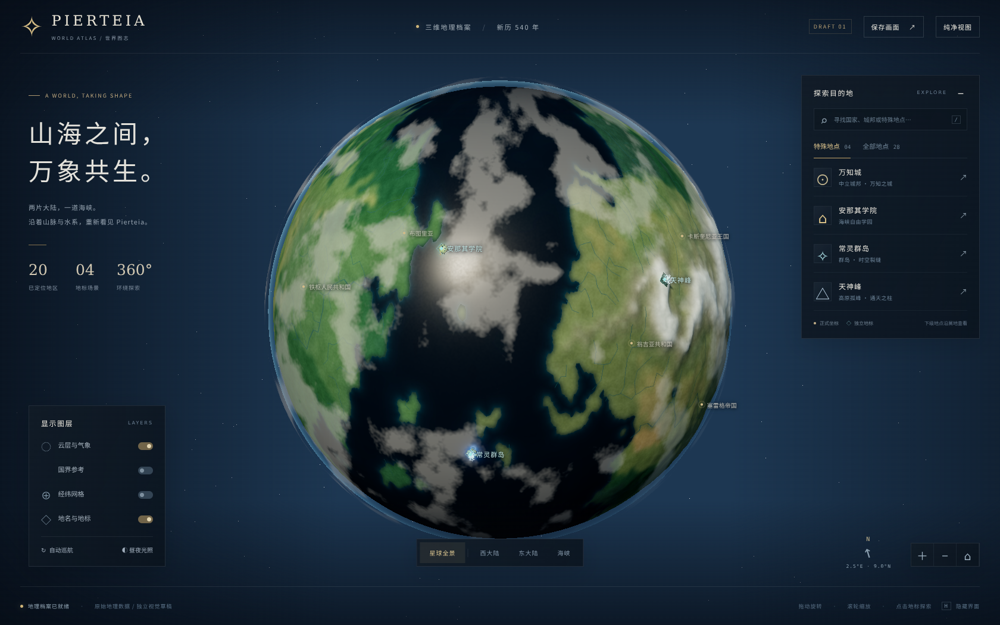
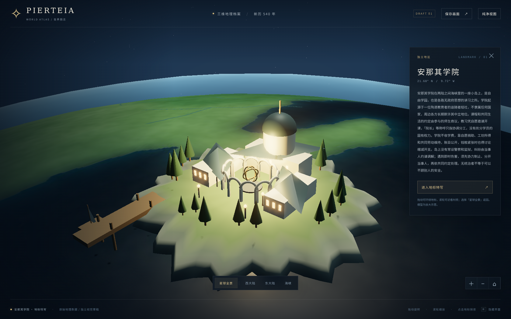
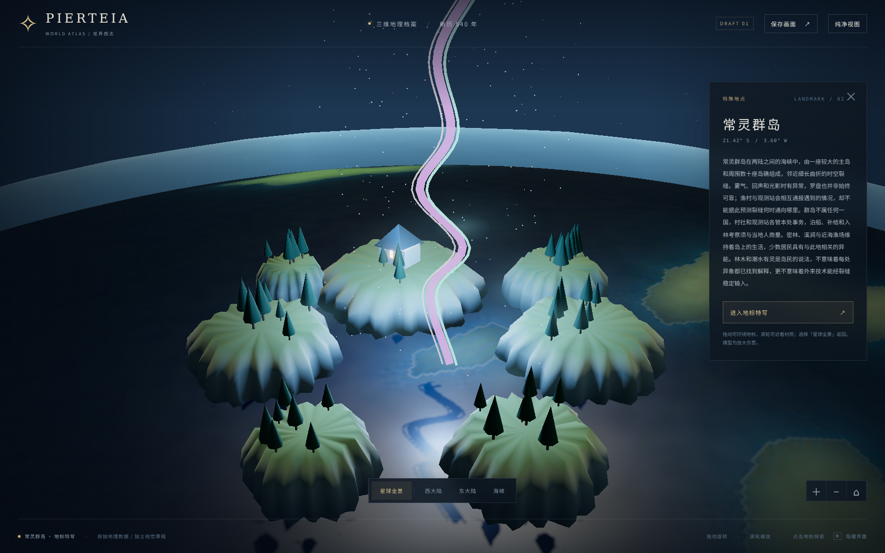
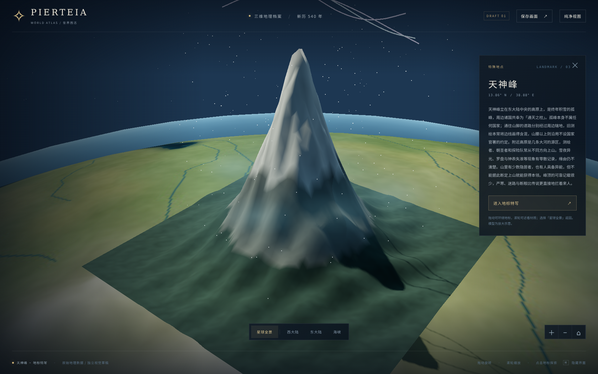
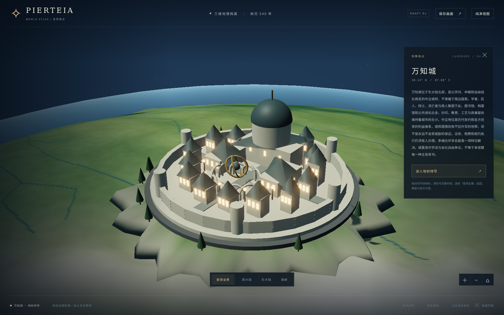

# Pierteia · 3D 星球草稿 01

这是单独保存的浏览器三维草稿。**未替换现有地图、未接入主站导航、未合并或发布。**

## 手机直接看截图

在 GitHub 打开本 README 即可向下浏览，无需访问 Arena 沙盒，也无需运行三维页面。点击图片可以查看原图。交互版源码也在本文件夹中；GitHub 文件浏览页面本身不运行 HTML / WebGL。

### 星球全景



### 安那其学院



### 常灵群岛与时空裂缝



### 天神峰



### 万知城



## 打开交互版

在此文件夹运行：

```sh
python -m http.server 8134 --bind 0.0.0.0
```

然后访问服务地址。需要支持 WebGL 2 的现代浏览器。请通过 HTTP 打开，不能直接双击 `index.html` 使用 `file://`：浏览器会限制模块和数据读取。运行时资源均在本目录，不依赖 CDN、外部地图或在线 API。

- 拖动旋转，滚轮/触摸手势缩放。
- 右侧选择地点，也可点击球面标签。
- 四个特殊地点可进入局部地标特写；「星球全景」恢复观察。
- 可切换云层、旧底图国界、经纬网、地点标签、自动巡航与昼夜展示。
- `H` 隐藏或恢复界面，`Esc` 返回；桌面 `/` 聚焦搜索。
- 「保存画面」下载当前三维画面PNG，不包括HTML界面；下面的成品截图包含界面。

## 已保存的实际渲染截图

| 文件 | 内容 |
|---|---|
| `screenshots/01-world-overview.png` | 星球全景、海陆、地点标记与控制界面 |
| `screenshots/02-anarchist-academy.png` | 安那其学院：海岛、院落、拱廊、建筑、码头与船 |
| `screenshots/03-changling-rift.png` | 常灵群岛：岛体、林木、薄雾、曲折裂缝与粒子 |
| `screenshots/04-tianshen-peak.png` | 天神峰：立体山体、积雪材质、飘雪与异光 |
| `screenshots/05-wanzhi-city.png` | 万知城：城墙、建筑群、图书馆式主体、广场和金属构件 |

截图分辨率1680×1050，来自本草稿实际运行的WebGL画面，不是图像生成概念图。地标采用程序化、偏风格化的微缩模型；本轮不是电影级写实资产或正式建筑设计。截图仅展示相应观察方向，其他角度可在实时场景中旋转查看。

## 原地图与设定如何保留

- 地理来源：仓库 `素材/地图/Pierteia Full 2026-09-19-01-11.json`，12,450个地图单元及原海岸、湖泊、河流、高程。
- 原文件明确经度−180°至180°、纬度90°至−90°。投影为 `lon = 360*x - 180`、`lat = 90 - 180*y`。平面图原纵横比与球面经纬投影不同，球面外观会有投影变化，不是重新布置大陆。
- 4K表面纹理、高程、粗糙度、湖海遮罩从原多边形生成；细部颜色与云雾是程序化视觉处理。植被色调参考现有地点志，不使用现实地球的大陆贴图。
- `assets/places.json` 快照保留20个已有正式地图坐标，以及全部28处地点志。8个没有独立坐标的下级地点可以检索并查看所属地区，不编造精确地图坐标。
- 1,732条原多边形共享边用于旧底图国界参考；国界图层默认关闭。旧底图含尚未设定地区，其边线不成为新增国家或对特殊地区主权的声明。
- 没有可用的地壳板块运动设定，因此不虚构地质板块分界；这里的“板块”实现为沿原图的大陆、海洋与地形。
- 没有采用生成器人口或面积值来重写世界规模。地表起伏、地标建筑、树木和粒子都经视觉放大，**不表示实际比例、海拔或建筑尺寸**。
- 学院岛体、群岛局部岛体和四处建筑/山体是地标坐标附近的示意建模，不覆盖或回写原地图。天神峰积雪与异光、常灵群岛裂缝等沿用文字设定；建筑布局和造型仅为此次草稿演绎。

## 文件

- `index.html`、`globe.css`：独立界面。
- `globe.js`：球体、灯光、大气、地图图层、标记、相机与交互。
- `landmarks.js`：四个程序化地标及材质、粒子、薄雾和动画。
- `assets/`：可离线读取的纹理、数据及字体子集。
- `vendor/`：Three.js 0.170.0与实际使用的附加模块，附MIT许可证；字体源自Noto Sans CJK SC，附SIL OFL许可证。
- `tools/build_textures.py`：纹理生成脚本，依赖 Pillow、NumPy、SciPy。只在重建纹理时需要Python依赖，观看页面不需要npm安装或构建。
- `assets/provenance.json`：来源、投影、分辨率与纹理种子。
- `screenshots/`：5张已保存的渲染截图。

## 验证与边界

已通过两个业务JS模块的语法检查；使用Chromium真实加载页面，确认20个标记、4个地标、28条地点资料，完成全景与四个地标场景的截图。该次加载与截图过程中没有捕获到页面脚本异常或HTTP错误。已逐张查看5张截图。

未完成全部控件的自动化回归、真实手机与各厂商显卡测试；高分辨率纹理与后期效果在低性能设备上可能偏慢。模型目前偏微缩/风格化，贴近地表时能看出原地图纹理的采样范围，局部地形边缘与材质仍有精修空间。本稿用于确认总体方向，不将建筑样式、模型尺度或纹理细节直接确认为世界观定稿。
