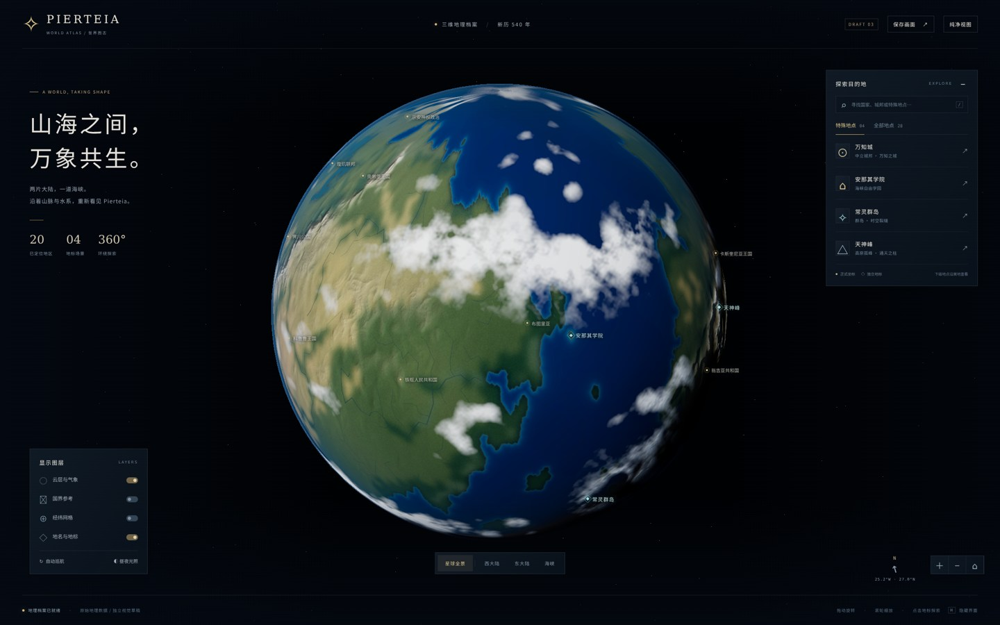
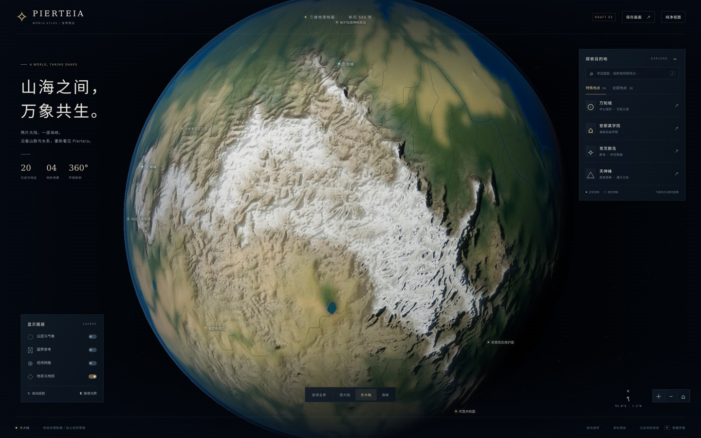
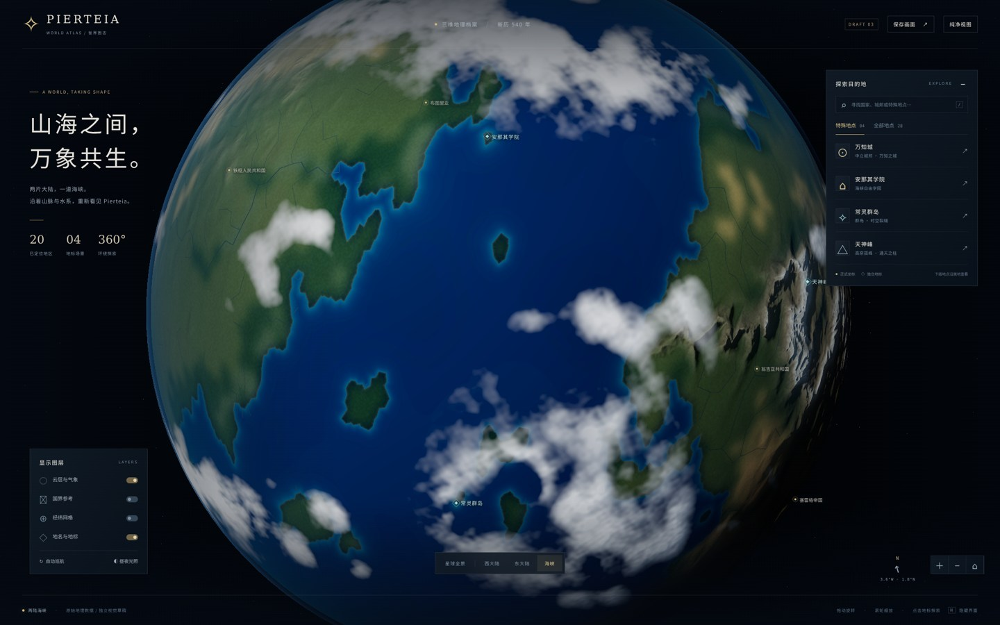

# Pierteia · 3D 星球草稿 03

**本轮单独重做星球本体。** 四处地标保留第二版模型；海陆轮廓、正式地点和坐标不变。独立草稿，未替换主站地图、未合并上线。

## 手机直接看最新球面

以下都是代码实际运行的截图。先加载较小 JPEG，点击查看 **2160 × 1350 PNG**。不需要 Arena 沙盒。

### 新版全景

[](screenshots/01-world-overview.png)

### 与第二版相同机位

[第二版旧图（固定历史版本）](https://github.com/xoqnapgf-dot/ynxz/blob/c9026f8f07833d521429df4f574a3a700ed3d265/drafts/pierteia-globe/screenshots/01-world-overview.png)。下图保持相同经纬度、距离和相机上方向，方便比较，不只是换个角度。

[](screenshots/08-planet-same-angle.png)

### 关闭云层，检查东大陆地形

[](screenshots/09-eastern-relief.png)

### 海峡云系与海洋

[](screenshots/10-strait-weather.png)

[第三版手机尺寸全景（390 × 844）](screenshots/06-mobile-overview.png)

## 第三版具体变化

- **地形**：以原始高程单元做 C1 连续插值，连接原有山系，再在高地范围加入受约束的细部山脊；压低平原的噪点和凹凸，避免遍地皱褶。6K 是合成纹理尺寸，不是测绘精度。
- **地表颜色**：区分原图的森林、草地、干旱地、岩地和积雪材料，降低饱和度；不使用国家色块，不重新划大陆。
- **海洋**：独立海陆着色，只在水面提供克制的反光；近岸渐变与原水域高度信号作视觉参考，去除插值造成的海上三角块感，不冒称实测海底地形。
- **天气**：球面三维噪声生成连贯云带、旋涡与大片晴空；厚云和高云分层，不再到处撒同样的小白点。天气是程序化美术演绎，不是气候模拟或新增世界设定。
- **光照**：新增独立球面着色模块，处理地表受光、云体明暗、移动云影、海面反光、薄大气和昼夜边缘；不改变四处地标原有灯光。
- **保持不变的内容**：`landmarks.js`、`places.json`、`lines.json`、`land-mask.png` 与第二版的 SHA-256 完全一致。20 个标记、28 处地点、1,732 条旧边界和 91 条河流记录保留。

## 第二版已完成的地标（本轮未改）

这四张沿用第二版实渲染截图，因此界面角标仍显示 DRAFT 02。

<details>
<summary>展开学院、万知城、天神峰与群岛</summary>

### 安那其学院
[](screenshots/02-anarchist-academy.png)

### 万知城
[](screenshots/05-wanzhi-city.png)

### 天神峰
[](screenshots/04-tianshen-peak.png)

### 常灵群岛
[](screenshots/03-changling-rift.png)

[第二版学院手机尺寸检查](screenshots/07-mobile-academy.png)

</details>

## 打开交互版

GitHub 文件页不执行 HTML/WebGL。将本文件夹放到静态 HTTP 服务中，或在本目录运行：

```sh
python -m http.server 8134 --bind 0.0.0.0
```

需要 WebGL 2。不要用 `file://` 直接双击：模块和数据读取会受浏览器限制。运行资源全部本地，无运行时 CDN、在线地图或 API 依赖。

- 拖动旋转，滚轮/触摸手势缩放；点击标签或地点列表。
- 特殊地点详情里点「进入地标特写」；「星球全景」或 `Esc` 返回。
- `H` 隐藏/恢复界面；桌面 `/` 聚焦搜索。
- 云层、国界参考、网格、标签可切换；支持巡航、固定太阳方向。
- 「保存画面」只下载 WebGL，不含 HTML 界面。本页截图包含界面。

## 地理与设定边界

- 来源：`素材/地图/Pierteia Full 2026-09-19-01-11.json`，12,450 个原始单元；没有用现实地球大陆替换。
- 投影：`lon=360*x-180; lat=90-180*y`。原平面图纵横比不同，球面外观存在投影变化。
- 8 处没有独立坐标的下级地点沿所属地区查询，不虚构点位。
- 旧国界默认关闭，生成器国界不改变特殊地区主权；没有地壳运动数据，不虚构地质板块线。
- 不使用生成器人口/面积改写世界规模。地表起伏、地标比例、建筑布局和局部景物是视觉演绎，不是实测海拔或新正史。
- 这仍是程序化三维草稿，不声称电影级写实或气象/地质模拟。

## 文件与复现

- `globe.js?v=3`：球面、图层、相机、地点与场景切换。
- `planet-materials.js?v=3`：独立球面、云层和大气着色。
- `globe.css?v=2` / `landmarks.js?v=2`：第二版界面与四地标，本轮未修改。
- `tools/build_textures.py`：地表、高程、法线与粗糙度。
- `tools/build_weather.py`：球面天气与高云；以上离线构建需要 NumPy、Pillow、SciPy，网页运行不需要 Python/npm。
- `assets/provenance.json` / `weather-provenance.json`：来源、哈希、投影和天气构建记录。
- `tools/validate.mjs`：运行 `node drafts/pierteia-globe/tools/validate.mjs`，检查资源、截图、坐标及本轮保留文件的 SHA-256。
- `tools/verification-v3.json`：本轮浏览器检查记录；没有把最终后期处理通道的三角形统计当成整个场景模型面数。
- `vendor/`：Three.js 0.170.0 与 MIT 许可证；Noto Sans CJK SC 字体子集附 SIL OFL 许可证。

## 本轮验证范围

- 业务 JS 模块语法和文件/数据检查通过。
- Chromium 实渲染四种球面视图，已查看；桌面没有捕获页面脚本、控制台/着色器或 HTTP 错误。
- 检查云层开关、昼夜开关、网格、国界、搜索、进入/返回地标和 `Esc`；四处原有地标均可加载，固定太阳状态进入再返回也通过。
- 新开浏览器完成 390 × 844 全景、进入学院与返回；无横向溢出，无捕获到的脚本/着色器/HTTP 错误。移动端 GPU 纹理缩到 2048 × 1024、像素比上限 1、阴影 1024。
- 这不是所有功能组合或真实手机性能验收；各厂商 GPU、长期内存/帧率仍需实机测试。不承诺绝对无 bug。
