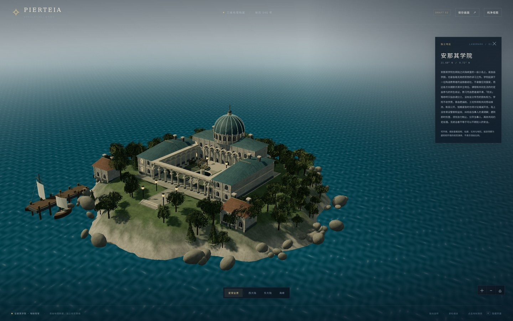
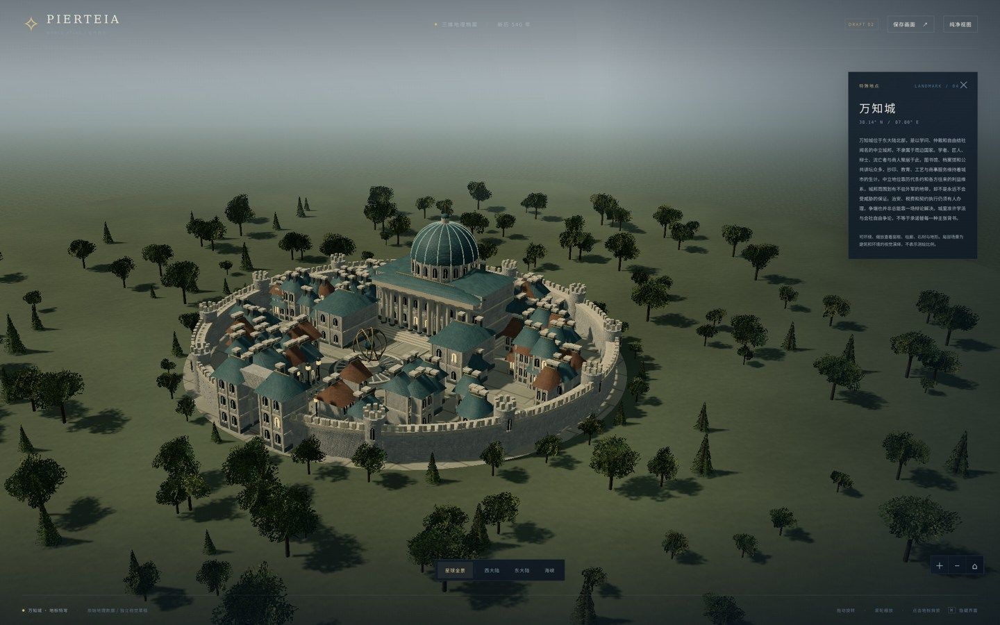
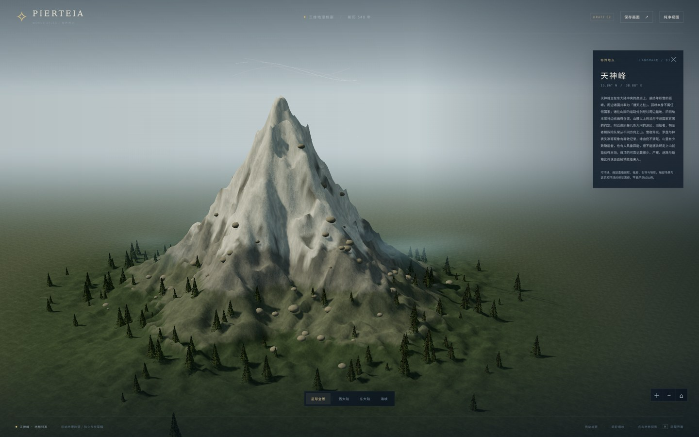
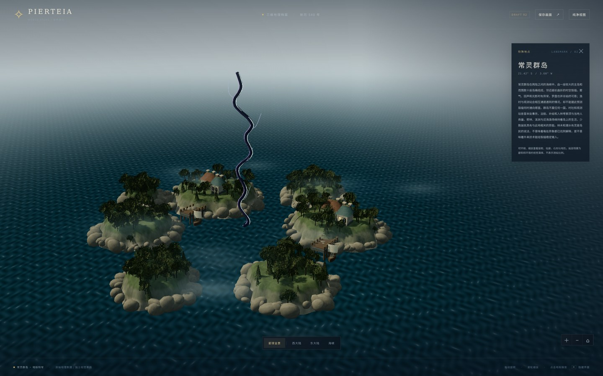
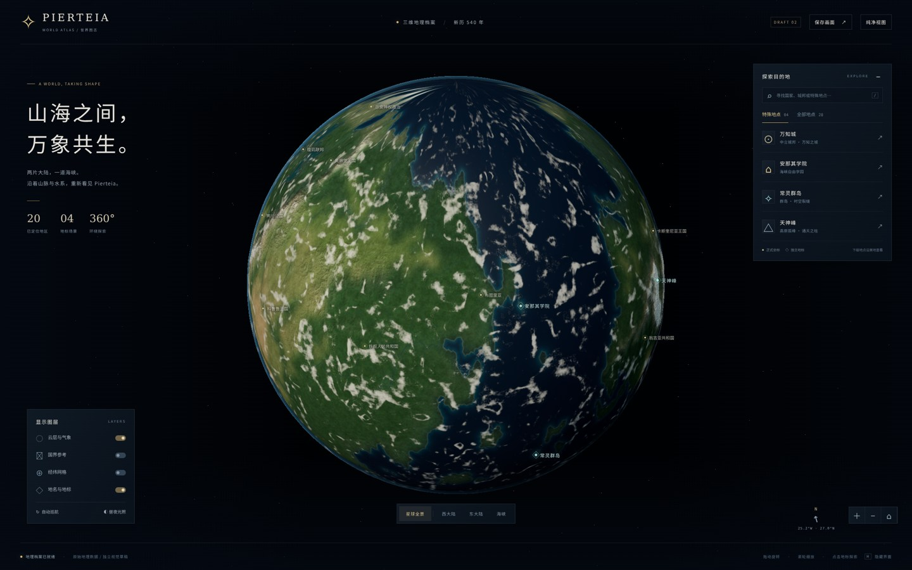

# Pierteia · 3D 星球草稿 02

**第二版：重做球面材质、四处地标与近景环境。** 独立保存在本文件夹，未替换正式地图、未接入主站导航、未合并上线。

## 手机直接看新版

下面先加载较小的预览图，**点击图片打开 2160 × 1350 的 PNG 原图**，可以放大检查细节。不需要 Arena 沙盒，也不用运行 WebGL。所有图片都是这份代码实际运行的截图，不是另画的概念图。

### 安那其学院 · 窗框、柱廊、庭院、码头

[](screenshots/02-anarchist-academy.png)

### 万知城 · 城墙、街区、图书馆与仪器广场

[](screenshots/05-wanzhi-city.png)

### 天神峰 · 山脊、积雪、碎石与山麓林地

[](screenshots/04-tianshen-peak.png)

### 常灵群岛 · 岛岸、林木、村舍与不规则裂缝

[](screenshots/03-changling-rift.png)

### 星球全景 · 原地图海陆、高程与正式坐标

[](screenshots/01-world-overview.png)

### 手机尺寸检查

下面是浏览器 **390 × 844** 视口的实际截图，不等于已经在真实手机硬件上测试。

[全景竖屏](screenshots/06-mobile-overview.png) · [学院竖屏](screenshots/07-mobile-academy.png)

## 相比第一版重做了什么

- **地表**：从原地图重新生成 6144 × 3072 表面颜色、高程、法线、粗糙度与海陆遮罩；取消按国家色块混合地表颜色。山地细纹受原高程约束，增加细部起伏、岩地/积雪过渡、近岸浅水；降低球体整体起伏夸张程度，减少塑料球感。
- **云与光照**：重做破碎云带、薄大气边缘、太阳入射方向和海面反光；全景不再把放大的玩具式建筑堆在星球上，正式标签进入独立局部场景。
- **学院**：立面分层、拱窗和窗框、柱础/柱头、连续柱廊、屋脊与烟囱、带肋穹顶、入口台阶、庭院花池、喷泉式水池与仪器、长椅、灯具、人物尺度参照、分块码头、船体/帆/索具。
- **万知城**：增加有间隔的街巷与密集建筑群，分段城墙、垛口、塔楼与门楼；重做图书馆立面、柱廊、阶梯、穹顶和仪器广场。移除旧版悬浮圆形底座。
- **群岛**：不规则起伏岸坡、岸礁、树木、村舍和小码头；裂缝有暗核、细亮边与分叉，配合薄雾和少量粒子。不解释为稳定航道或工业技术来源。
- **天神峰**：山体网格提升至 320 × 320 分段，增加山脊、肩峰、岩雪过渡、碎石与林地；地形外围改为圆形渐隐衔接，不再裸露矩形底板。雪与异光仍是设定的视觉演绎，不是测绘结果。
- **近景材质**：程序生成石块、岩石、木纹、屋面、法线及带透明裁切的树叶纹理；不再全部用纯色平面。水面改为动态细波，局部天空/远景雾不再使用模糊的球面地表当背景。
- **绘制与手机布局**：静态几何按材质合批；手机初始加载将 GPU 纹理缩到 2048 × 1024、像素比上限 1、阴影降到 1024；调整特写相机和右侧说明面板，补全新文案所需中文字体。

这次仍然是**程序化、风格化的三维草稿**。增加细节不等于电影级写实：复杂植被、山地侵蚀、海浪、建筑内部及建筑尺度仍有简化；没有用“精度拉满”代替实际画面验收。

## 打开交互版

GitHub 文件浏览页只显示源码和图片，不运行 HTML / WebGL。要运行交互版，请将整个目录放在静态 HTTP 服务中，或在本目录运行：

```sh
python -m http.server 8134 --bind 0.0.0.0
```

需要支持 WebGL 2 的现代浏览器。不要双击 `index.html` 用 `file://` 打开：模块与数据读取会受到浏览器限制。运行资源都在本目录，没有运行时 CDN、在线地图或 API 依赖。

- 拖动旋转；滚轮或触摸手势缩放。
- 点球面标签或右侧地点；特殊地点的详情有「进入地标特写」。
- 「星球全景」或 `Esc` 返回；`H` 隐藏/恢复界面；桌面 `/` 聚焦搜索。
- 云层、旧底图国界、经纬网、地点标签可切换；支持自动巡航和固定太阳方向。
- 「保存画面」下载 WebGL 画面，不含 HTML 界面。本目录交付截图包含界面。

## 地图与设定边界

- 原始地理：仓库 `素材/地图/Pierteia Full 2026-09-19-01-11.json`，12,450 个单元及原海岸、湖泊、河流、高程；没有用现实地球大陆贴图替换。
- 原文件经度范围 −180° 至 180°，纬度 90° 至 −90°；映射 `lon=360*x-180`、`lat=90-180*y`。原平面图纵横比与球面不同，球面有投影变化，并非重排大陆。
- 6K 是合成纹理分辨率，不是 6K 测绘精度。单元内部山脊、表面颗粒、云带、岸礁与林木属于视觉补充；没有声称原图包含实测侵蚀、气候或岩性数据。
- `assets/places.json` 保留 20 个正式坐标、全部 28 处地点志。8 个没有独立坐标的下级地点沿所属地区查询，不编造点位。
- 1,732 条旧底图国界段默认关闭；未设定地区不添加名称或主权。学院、常灵群岛、天神峰的独立设定不因底图色块改变。
- 没有地壳运动数据，因此不虚构地质板块分界。
- 不采用生成器人口或面积重写世界规模。球面高程和局部地标均做视觉放大，建筑布局、人物、船只等仅用于表现环境和尺度感，不成为新正史。
- 万知城使用内陆地表；学院与群岛使用局部水面；所有特写都是坐标关联的视觉场景，不回写或覆盖正式地图。

## 文件与复现

- `index.html` / `globe.css`：独立界面，当前资源版本 `v=2`。
- `globe.js`：星球材质、图层、地点、相机、局部场景切换。
- `landmarks.js`：四处地标、程序材质、树叶裁切纹理、水面与特效；静态几何合批。
- `assets/`：6K 地表贴图与高程、4K 云层、数据、中文字体子集；`provenance.json` 记录来源和投影。
- `tools/build_textures.py`：从原地图重建地表贴图；需要 Pillow、NumPy、SciPy，仅离线重建时需要，网页运行无需 Python 或 npm。
- `tools/validate.mjs`：基础文件、数据和截图检查，运行 `node drafts/pierteia-globe/tools/validate.mjs`。
- `vendor/`：Three.js 0.170.0、所需附加模块和 MIT 许可证；字体源自 Noto Sans CJK SC，附 SIL OFL 许可证。
- `screenshots/`：5 张桌面 PNG、2 张移动视口 PNG；`previews/` 为方便手机浏览的较小 JPEG，不是另一套渲染。

## 验证记录

- 两个业务 JS 模块语法检查通过，原始 20/28 地点数据保持不变。
- Chromium 实际渲染五处桌面画面，尺寸 2160 × 1350；已查看全景和四处近景。
- 实际点击验证：返回全景、云层、网格、国界、巡航、缩放、搜索、进入特写；键盘 `Esc` 与 `H` 验证通过。
- 第一次在桌面连续渲染后切换移动视口并重载，触发 30 秒导航超时；没有把该次超时算作通过。之后新开浏览器，完成 390 × 844 全景/学院特写、真实按钮点击和截图；无横向溢出，该次未捕获脚本/控制台错误或 HTTP 错误。
- 真机性能、所有移动浏览器/显卡、长时间切换的内存与帧率、所有地点和控件组合仍未完整验证。高分辨率资源的首次下载在手机网络上可能偏慢，先看本页轻量预览图即可。
