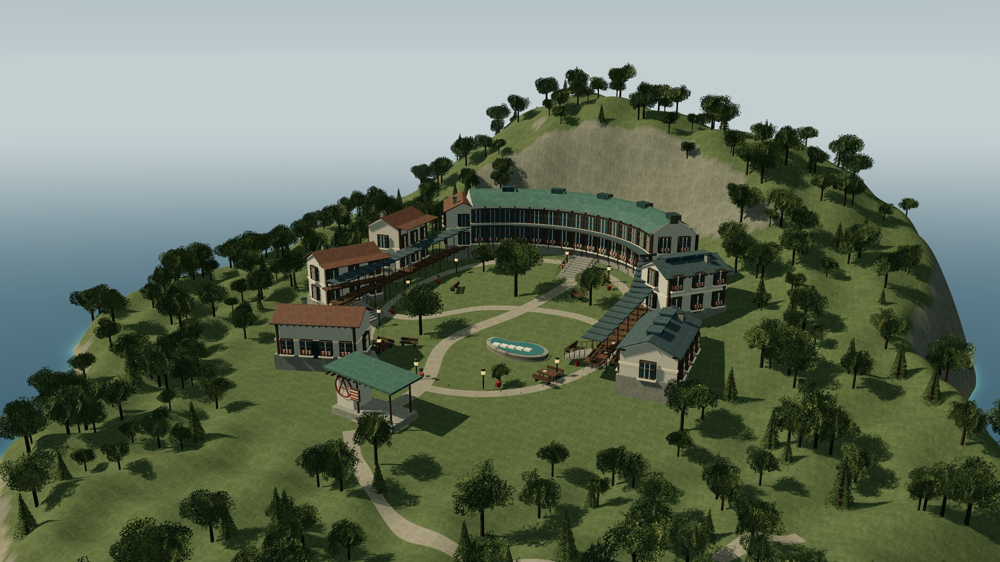
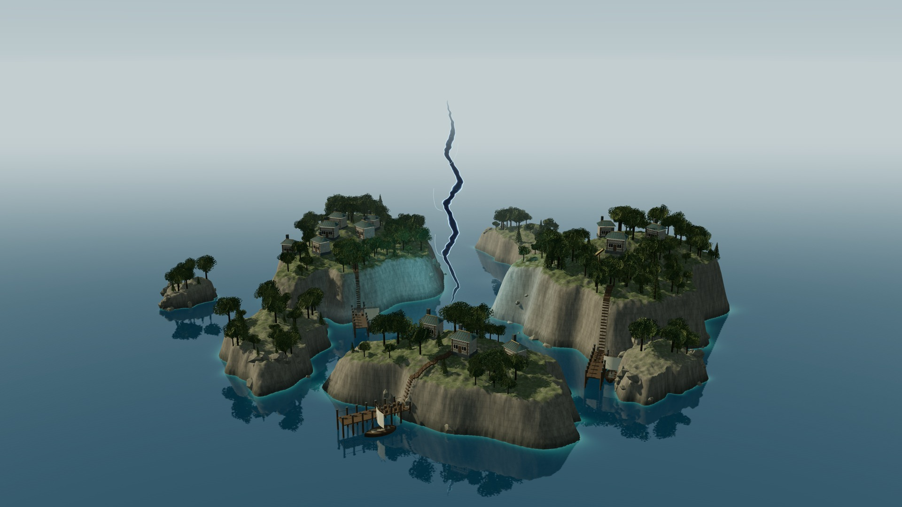
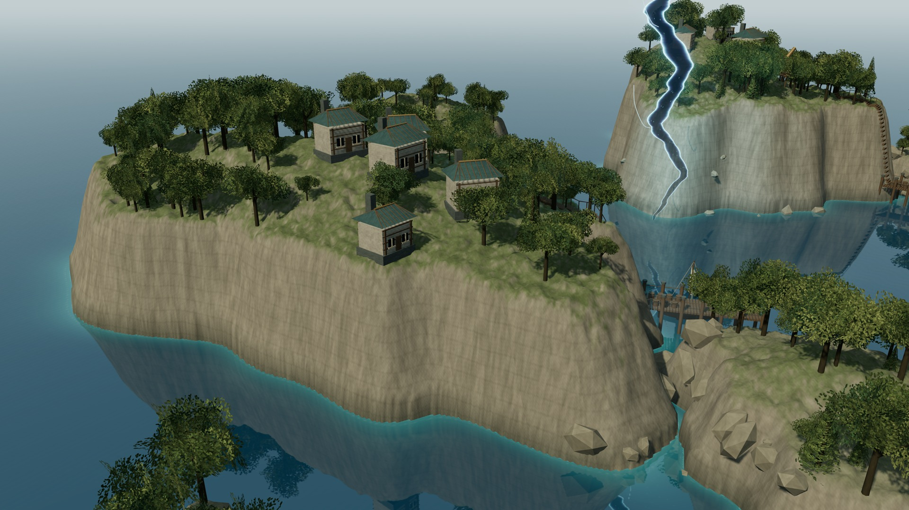
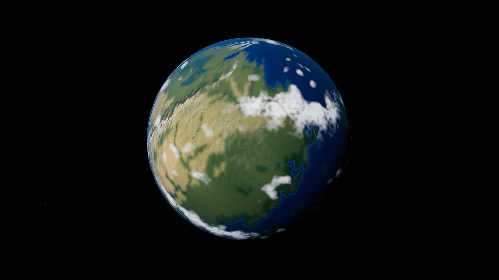

# 第七版资产接入中 · Blender 阅览室

已实际使用 Blender 4.2 导出 `assets/atelier/academy-atelier.glb`，保留可旋转三维模型，不是把渲染图贴进网页。真实窗洞、逐片屋瓦、石材倒角、木构、玻璃、室内书架及圈 A 金属构件均在资产中。

当前已接入网页加载、环境反射与接触遮蔽；本次先保存源码、模型和原始材质，网页近景正在验证，尚未把新成片列为已完成。

- 建模重建脚本：`tools/build_atelier.py`；资产来源说明：`assets/atelier/provenance.json`。
- 全部几何及材质为自行制作的程序化资产，不是扫描材质；没有声称 Blender 离线渲染图等同于网页效果。
- 仍为独立草稿，不改主站、不合并main、不自动上线。
- 缓存入口及改动模块为v7；尚未改动的模块保留原版本。

---

<details><summary>第六版及此前历史记录（不是本轮效果）</summary>

# Pierteia · 学院重设计 / 草稿 06

这次只改学院。上一版的整圈高墙、双塔门楼和同心台阶已经撤掉；**保留环形总布局，改成沿山势错层的独立楼群与开放庭园**。仍是可运行的 Three.js 场景，不是概念图。

## 当前学院实渲染

下图为1920×1080浏览图。点击打开 **3840×2160、4次抖动采样的原生PNG**，不是放大工作截图。

[](screenshots/v6/21-academy-open-campus.png)

### 这次改变的是建筑组织

- **北侧弧形图书馆**：沿等高线展开，书架窗、玻璃窗格、采光顶和面向庭园的细木柱廊。
- **西侧教学楼**：三栋不同标高的坡屋顶楼，以外廊、阳台与短阶梯衔接，不再重复整圈拱券。
- **东侧工坊**：较低的体量、屋顶采光窗、外部工作桌；与教学楼使用不同的屋面和比例。
- **南侧公共活动室及入口**：低矮门廊，没有堡垒式双塔。圈 A 是入口墙上的立体构件，另有公告栏。
- **中心庭园**：依地势起伏的环形步道、树木、阅读桌椅、小水池与穿行小径；没有中央竞技场或同心看台。
- **山体关系**：各楼单独落在局部基础上，以有顶连廊连接；去掉整座校园下方的大圆形台座及山顶圆塔。

仍是程序化建筑草稿，不宣称达到写实扫描资产或正式建筑设计深度。本轮先交付整体构图，避免在方向未经确认前继续堆细节。浏览器内仍可环绕、缩放，学院有「全景／街区近景」机位。

## 交付及检查范围

- 本轮仅新增一张学院4K成片，见 `screenshots/v6/`；浏览器记录见 `tools/verification-v6.json`。
- 检查学院加载、4K导出、入口近景按钮、Esc返回、搜索及重新进入；不是重新验证所有八个场景。
- 顺带修正共用步道网格的三角形绕序，避免路面朝下而不可见。
- 原八场景目录和按需构建保留；群岛、铁枢、璇玑、法洛塔、汐见町本轮没有继续扩建。上一批多图4K任务已停止，不能当作全部成片已完成。
- 正式20坐标、28地点、海陆、湖泊与parent关系不变；二级地点没有新增坐标。
- **独立草稿，不合并main、不自动上线，不替换主站。**

## 运行

在本目录运行 `python -m http.server 8134 --bind 0.0.0.0`，浏览器打开HTTP地址。需要WebGL 2；所有运行资源本地自包含，没有运行时CDN。

- 选学院后点击「进入场景特写」。拖动环绕、滚轮缩放；Esc返回，H隐藏界面。
- 「4K PNG」会临时暂停动画，导出后恢复渲染状态；软件WebGL导出较慢，不是显卡性能基准。
- 缓存：globe/index引用、landmarks、academy-hillside、regional-scenes为v6；未改的archipelago-hq/scene-catalog为v5，planet-materials为v3。

## 历史版本

[已否定的整圈高墙学院工作图](screenshots/v5/academy-working-view.jpg)仅保留作修改记录，不代表当前方案。

<details><summary>第四版历史说明与成片（不是第五版效果）</summary>

# Pierteia · Desktop HQ / 草稿 04

**按桌面高画质制作，不再为手机缩小纹理、网格或阴影。** 群岛本轮重做；三张4K成片已实际渲染、查看并保存。独立草稿，不替换正式地图、不自动合并上线。

## 4K 实渲染成片

下方是方便浏览的 JPEG。**点击图片打开原生 3840 × 2160 PNG**。每张用4次不同亚像素位置的场景渲染累积抗锯齿，不是放大旧截图；成片不含网页控制面板。

### 群岛全景

[](screenshots/hq/11-islands-hq.png)

### 岸崖与村落近景

[](screenshots/hq/12-harbor-hq.png)

### 星球全景

[](screenshots/hq/13-planet-hq.png)

## 这轮实际提升

- **群岛地形**：640×640分段的连续地形，单地形819,200个三角面；不同长宽、朝向、海湾切口、肩部起伏的岛体，不再摆七个相似的圆盘。整体群岛场景统计955,630个三角面，含水面、植被、建筑和特效；这只是复杂度记录，不等于质量评分。
- **岸崖材质**：顶面植被与坡面岩石按高度/坡度混合；增加潮湿岩脚、细部法线、岩层条带和局部碎岩。保留索引网格，避免百万级三角形全部展开成重复顶点。
- **村落与环境**：12栋带窗框、木构、屋面细部的村舍，287株地形约束的树木；补观测平台与小型仪器、步道、岸壁木梯、带桩柱和绳栏的码头、桶与帆船。树木避开房屋，不再穿插在住宅里。
- **水面**：真实平面反射相机/1024反射贴图，反映实际岛体、植被和裂缝，不是画一张假倒影。16位打包的局部高度场控制浅水色和岸边泡沫；两层移动法线、菲涅耳反射与细波扰动。水面仍是实时近似，不是流体模拟。
- **裂缝**：从黑色圆管改成两侧不规则、首尾收细的片状裂口，加入暗核、细亮边、分叉、粒子、薄雾和局部冷色照明；保持设定中的细长曲折裂缝，不改成圆形传送门。
- **桌面画质**：完整6K地表贴图，球面1024×512分段，云壳320×160分段，4096阴影（受显卡硬上限约束），最高可用各向异性过滤；没有按屏幕宽度缩成2K纹理或降低网格。
- **成片导出**：「4K PNG」按钮导出3840×2160、4样本SSAA；导出时暂停动画/巡航，并在成功或失败后恢复分辨率、相机、后期通道和按钮。4K导出较耗时，不保证过程中实时交互。
- **相机**：群岛特写提供「全景／海岸／裂缝」三个视角，仍可手动环绕、缩放。其余三处地标结构沿用已完成版本，共享阴影和树叶材质得到更新。

这是一轮高画质程序化场景，不宣称无限精度或电影级扫描资产。当前天空较简洁，海面偏平静，局部崖壁、建筑布局和植被仍有风格化与重复细节。没有加入完整光线追踪、路径追踪、体积云求积或物理海浪模拟，也不把这些尚未实现的技术列作成果。

## 打开与操作

GitHub 文件页只展示文件与图片，不执行 WebGL。把整个文件夹放在静态 HTTP 服务中，或在本目录运行：

```sh
python -m http.server 8134 --bind 0.0.0.0
```

需要 WebGL 2 和较充裕的桌面显存。不要用 `file://` 双击。运行资源全部在本目录，没有运行时 CDN、在线地图/API依赖。

- 拖动旋转，滚轮缩放；点标签或地点列表，再选「进入地标特写」。
- 「星球全景」或 `Esc` 返回；`H` 隐藏界面；桌面 `/` 搜索。
- 云、旧国界、网格、标签可切换；支持巡航和固定太阳。
- 「4K PNG」输出当前三维场景，不含HTML标签和界面；需要浏览器允许下载。
- 移动布局代码仍保留，但**不再把手机性能作为本轮画质目标**。

## 地图与设定没有改写

- 原始地理仍来自 `素材/地图/Pierteia Full 2026-09-19-01-11.json` 的12,450个单元。经纬映射保持 `lon=360*x-180; lat=90-180*y`。
- 20个正式标记、28处地点志、1,732条旧边界、91条河流与正式海陆遮罩均未改；8处无独立坐标的下级地点仍不补造点位。
- 群岛单岛轮廓、村舍、树木、岩层和码头是**标记附近的局部美术演绎**，不回写正式地图，不表示新增正史或测绘岸线。
- 没有凭空划地质板块、新增主权或使用生成器人口/面积重写世界规模。模型与地形起伏的比例仍是视觉放大。
- 6K是合成贴图尺寸，不是原图的实测精度。第三版原始地图来源哈希、地形与天气说明仍在 `assets/*provenance.json`。

## 验证

- `globe.js`、`landmarks.js`、`archipelago-hq.js` 模块语法检查通过。
- Chromium实际完成三张原生4K、4样本导出；已查看全部成片。
- 导出后的搜索、进入特写、三个群岛相机按钮、`Esc`、云层、太阳切换和四处地标加载已检查。该次没有捕获页面脚本、控制台/着色器或HTTP错误。
- 本机为软件WebGL，群岛两张4K导出分别约38秒和57秒；这不是实际桌面显卡的性能基准，也不承诺所有设备同样耗时。
- 检查结果：`tools/verification-v4.json`。其中renderer最后一遍后期通道的三角形统计不代表场景总模型面数，模型统计单独记录在geometry中。
- 尚未覆盖所有显卡、长时间内存回收、全部控件组合、下载权限差异。不承诺绝对无bug。

基础文件验证：

```sh
node drafts/pierteia-globe/tools/validate.mjs
```

## 文件与版本

- `globe.js?v=4`：桌面HQ配置、控制、4K累积导出。
- `archipelago-hq.js?v=4`：群岛地形、村落、水面反射、岸线效果和裂缝。
- `landmarks.js?v=4`：四处地标入口与通用建模/材质工具。
- `globe.css?v=4`：界面和群岛视角按钮。
- `planet-materials.js?v=3`：上一轮球面/云层着色，逻辑未改。
- `tools/build_textures.py`、`build_weather.py`：原图纹理与天气的离线重建，需要Pillow/NumPy/SciPy，网页运行无需安装这些依赖。
- `vendor/`：Three.js 0.170.0及Water、SSAARenderPass等实际使用模块，保留MIT许可证；Noto中文字体附SIL OFL许可证。
- `screenshots/hq/`：本轮3张4K PNG；其下previews为JPEG浏览图。
- `screenshots/01`—`10`：前轮记录，不作为本轮4K成片；`11-islands-work-preview.png`为收尾前工作预览，不冒充最终成片。

[第三版球面制作记录（历史版本）](https://github.com/xoqnapgf-dot/ynxz/blob/811c8bc/drafts/pierteia-globe/README.md)

</details>

</details>
